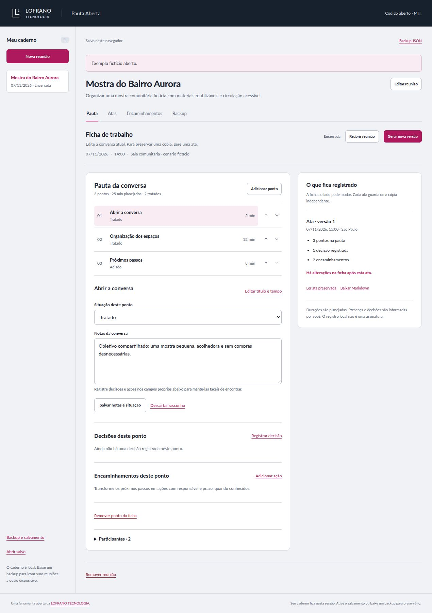

# Pauta Aberta

Prepare a pauta, registre decisões e acompanhe encaminhamentos sem perder a ata da reunião. A ficha continua editável; cada versão da ata guarda uma cópia independente dos nomes, pontos, responsáveis, prazos e estados daquele momento.

Aplicativo aberto da [LOFRANO TECNOLOGIA](https://lofranotecnologia.com.br), feito para pequenas equipes, coletivos e projetos comunitários. Funciona no navegador, sem conta, backend ou serviço de IA. O primeiro uso é vazio; o exemplo só é aberto quando você escolher.

[Abrir demonstração](https://martinlofranodeoliveira.github.io/pauta-aberta/) · [Baixar a versão 1.0.0](https://github.com/martinlofranodeoliveira/pauta-aberta/releases/tag/v1.0.0)

<details>
<summary>Ver a interface com dados fictícios</summary>



[Ver a interface no celular](docs/images/pauta-mobile.jpg).

</details>

## Comece em poucos minutos

Com **Node.js 22 ou superior** e npm, na pasta do projeto:

```sh
npm ci
npm run dev
```

Abra [http://127.0.0.1:4191](http://127.0.0.1:4191). O comando prepara os arquivos estáticos e inicia a prévia local. Para encerrar o servidor, use `Ctrl+C`.

O navegador precisa oferecer módulos JavaScript e, para o salvamento opcional, IndexedDB. Sirva os arquivos por HTTP; abrir `index.html` diretamente com `file://` não é o fluxo de execução suportado.

## Da pauta à ata

1. **Crie uma reunião.** Informe título, objetivo e, quando conhecidos, data, horário e local. Adicione participantes e pontos da pauta, na ordem da conversa.
2. **Reserve tempo para cada ponto.** As durações são planejadas, sem cronômetro. Zero significa que o ponto não tem tempo reservado.
3. **Inicie a reunião.** Registre notas, marque pontos como tratados ou adiados e associe decisões e encaminhamentos ao assunto de origem. Responsável e prazo podem continuar ausentes.
4. **Encerre e gere a ata.** Confira a confirmação para preservar a primeira versão. Pontos pendentes e informações ausentes entram no registro como estão; o aplicativo não declara consenso ou conclusão por você.
5. **Continue na ficha de trabalho.** Uma ação pode ser concluída depois da reunião. Isso altera o acompanhamento atual e mantém a ata anterior intacta. A interface avisa quando a ficha difere da última ata.
6. **Gere outra versão quando necessário.** Com a reunião encerrada e a ficha alterada, use **Gerar nova versão**. Em **Atas**, escolha explicitamente uma versão histórica ou a ficha atual para ler e exportar.

Reabrir uma reunião permite outro ciclo de conversa. Remover um ponto ou participante exige confirmação dos vínculos que serão desfeitos na ficha atual; os textos das decisões e ações permanecem, e as atas anteriores conservam seus próprios vínculos. Remover a reunião inteira também remove suas atas do caderno atual.

Texto digitado e ainda não submetido aparece como **rascunho não salvo**. Ele é mantido em memória ao atualizar a tela ou trocar de ponto, reunião e área interna. Nas notas, use **Salvar notas e situação** ou **Descartar rascunho**; nos demais editores, **Salvar na ficha** ou **Cancelar**. Antes de baixar o backup ou a ficha de trabalho, gerar ata, substituir por uma importação ou abrir o salvo, resolva os rascunhos pendentes. Atas históricas continuam disponíveis; o CSV reúne somente ações já salvas na ficha. Um rascunho não faz parte do backup nem do salvamento local até ser salvo na ficha.

## Seus arquivos e o salvamento

O uso começa em **sessão temporária**. Fechar a página pode perder o que ainda não foi salvo ou exportado.

Ao sair ou recarregar com rascunhos pendentes, a aplicação tenta solicitar o alerta do navegador. Esse alerta depende do navegador e não garante o bloqueio da saída ou a recuperação do texto depois de fechar a página.

- **Backup JSON:** preserva o caderno completo, incluindo todas as atas. É o formato para continuar o trabalho ou levar o caderno a outro dispositivo. A importação valida tudo e mostra uma prévia antes de substituir a sessão.
- **Markdown:** compartilha uma ata histórica escolhida ou uma ficha de trabalho claramente identificada. Textos digitados permanecem texto, sem se transformar em HTML, links, listas ou títulos adicionais.
- **CSV:** reúne encaminhamentos das fichas atuais, com o filtro escolhido, associação ao ponto, responsável, prazo, estado e indicação de atraso. Não inclui cópias históricas das ações.

Em **Backup**, escolha **Ativar salvamento** para gravar neste navegador. A partir daí, alterações válidas da sessão são salvas localmente. Na próxima visita, use **Abrir salvo**. O salvamento pertence à origem e ao perfil do navegador; não sincroniza dispositivos. Se outra aba mudar a revisão, as gravações são interrompidas para preservar a sessão atual. Baixe seu backup antes de escolher qual caderno manter.

**Desativar e apagar salvamento** remove o caderno persistido desta aplicação e mantém a sessão atual aberta. Limpeza de dados do navegador, navegação privada, indisponibilidade ou limites de armazenamento também podem afetar o salvamento. Mantenha backups dos registros que quiser conservar.

O aplicativo não envia o conteúdo do caderno para um servidor e não carrega ferramentas de análise ou fontes remotas. **O caderno e seus backups não são criptografados pelo aplicativo.** Quem tem acesso ao perfil do navegador ou ao arquivo pode ler e modificar os registros. O histórico local não é uma assinatura, comprovação de presença, registro inviolável ou ata oficial.

## Datas e exportações

Datas de reunião e prazos são datas civis `AAAA-MM-DD`; não são convertidas para UTC. Um prazo vazio continua ausente. Apenas uma ação aberta, com prazo anterior a hoje, aparece em atraso. A interface calcula hoje no fuso **America/Sao_Paulo**.

O instante de uma ata, `closedAt`, é separado da data da reunião: fica no JSON como ISO UTC canônico com milissegundos, por exemplo `2026-11-07T18:00:00.000Z`. A interface o apresenta em São Paulo; a exportação Markdown identifica explicitamente UTC. Esse instante é informado pelo dispositivo, sem certificação externa.

O CSV usa vírgula, campos entre aspas, aspas internas duplicadas e registros terminados por CRLF. Células textuais cujo início, após espaços, seja `=`, `+`, `-`, `@`, tabulação ou retorno de carro recebem um **apóstrofo antes do valor original** para neutralizar fórmulas de planilha. Essa proteção afeta somente o CSV; o JSON preserva o texto original. Markdown e CSV são relatórios, não substitutos do backup completo.

## Um exemplo para explorar

Escolha **Explorar exemplo fictício** na aplicação ou abra [examples/caderno-exemplo.json](examples/caderno-exemplo.json) pela área de importação. Se já houver um caderno, a substituição passa por prévia e confirmação.

O cenário **Mostra do Bairro Aurora** contém duas pessoas fictícias, três pontos, uma decisão e dois encaminhamentos. A primeira ata foi preservada antes de um encaminhamento ser concluído na ficha. Compare:

- [Ata · versão 1 em Markdown](examples/ata-versao-1.md), com os estados daquele registro.
- [Encaminhamentos atuais em CSV](examples/encaminhamentos.csv), calculados para **08/11/2026**.

Os arquivos são gerados por `createExampleNotebook()` e pelos exportadores reais. Nenhum registro representa uma pessoa, reunião ou organização real.

## Limites explícitos

| Item | Limite |
| --- | ---: |
| Caderno completo e JSON de importação | 2 MiB de UTF-8 |
| Reuniões por caderno | 20 |
| Participantes por reunião | 20 |
| Pontos por reunião | 30 |
| Decisões por reunião | 100 |
| Encaminhamentos por reunião | 100 |
| Versões da ata por reunião | 12 |
| Tempo de um ponto | 0 a 480 minutos |
| Soma do tempo planejado por reunião | 1.440 minutos |

O limite de 2 MiB inclui todos os snapshots, a estrutura e a formatação do JSON canônico. Não há truncamento silencioso nem remoção automática de atas para abrir espaço. Datas válidas abrangem os anos 0001 a 9999. Os demais limites de texto, campos e vínculos estão em [SPEC.md](SPEC.md).

## Desenvolver e adaptar

```sh
npm test
npm run build
npm run check
npm run preview
```

`npm run build` prepara `dist/`; essa pasta é a saída para hospedagem estática. `npm run preview` serve a saída já preparada na mesma porta local. Node e npm são ferramentas de desenvolvimento; a aplicação entregue usa HTML, CSS e módulos ES, sem dependências JavaScript de terceiros em execução.

| Arquivo | Responsabilidade |
| --- | --- |
| `assets/domain.mjs` | Validação, estados, operações puras e snapshots |
| `assets/formats.mjs` | Markdown histórico, ficha atual, CSV e contagens |
| `assets/store.mjs` | IndexedDB opcional, transações e revisão contra conflitos |
| `assets/app.mjs` | Interface e ligação dos fluxos |
| `assets/example.mjs` | Construção do cenário inteiramente fictício |
| `SPEC.md` | Contrato do documento e das APIs |

As operações do domínio recebem e devolvem um caderno completo sem alterar o argumento. Nas APIs de encerramento e nova ata, o instante UTC é um argumento explícito. Um uso mínimo:

```js
import * as D from './assets/domain.mjs';
import { minutesMarkdown } from './assets/formats.mjs';

let book = D.createMeeting(D.emptyNotebook(), {
  id: 'encontro', title: 'Encontro fictício', date: '2026-11-08',
});
book = D.addTopic(book, 'encontro', {
  id: 'abertura', title: 'Definir próximos passos', minutes: 10,
});
book = D.startMeeting(book, 'encontro');
book = D.closeMeeting(book, 'encontro', '2026-11-08T18:00:00.000Z');
const markdown = minutesMarkdown(book.meetings[0], 1);
```

Os testes usam implementações independentes de IndexedDB, DOM, Markdown e CSV para conferir persistência, interface e exportações. Isso não equivale a certificação de acessibilidade, segurança ou integridade jurídica. Veja [CONTRIBUTING.md](CONTRIBUTING.md) para contribuir e [SECURITY.md](SECURITY.md) para relatar problemas sem expor dados.

## Licença e autoria

Código e documentação próprios sob [MIT](LICENSE), por **Contribuidores da LOFRANO TECNOLOGIA, 2026**. Você pode estudar, adaptar e hospedar sua versão, preservando os avisos da licença. A fonte Lato mantém sua licença SIL Open Font License 1.1; bibliotecas de desenvolvimento mantêm suas próprias licenças. Consulte [THIRD_PARTY_NOTICES.md](THIRD_PARTY_NOTICES.md).

[LOFRANO TECNOLOGIA](https://lofranotecnologia.com.br) · [Código e contribuições](https://github.com/martinlofranodeoliveira/pauta-aberta) · [Histórico de alterações](CHANGELOG.md)
